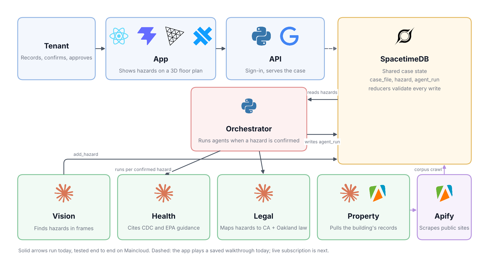

# Home

Help for renters living with unsafe housing. A tenant films a walkthrough of their home. Claude agents spot hazards like mold, leaks, pests, exposed wiring or missing heat. For each hazard the tenant confirms, the agents explain the health risk, the landlord's legal duty and the tenant's options, with a source cited for every claim. They also look up the building's public record (owner, code violations, permits, inspections).

Built at Cal Hacks 13.0 (Oct 23–25, 2026) with **Claude**, **SpacetimeDB** and **Apify**.



## How it works

1. **Vision agent** (`agents/vision/`) samples frames from a video or photos and sends them to Claude. Claude reports hazards using the 9 hazard tags in `docs/contracts.md` section 1. With `--save`, each hazard is written to SpacetimeDB as unconfirmed.
2. **The tenant confirms** each hazard (`confirm_hazard`). Nothing downstream runs on a guess.
3. **The orchestrator** (`integration/orchestrator.py`) watches SpacetimeDB and starts agents for each confirmed hazard, in parallel:
   - **Health agent** (`agents/health/`): health risks, cited to CDC, EPA and CDPH pages that Apify crawled into the database.
   - **Legal agent** (`agents/legal/`): landlord duties and tenant options, cited to a verified statute pack in `data/packs/`.
   - **Property agent** (`agents/property/`, opt-in): the building's history from public records, through Apify and open-data portals.
4. Every agent records its run in SpacetimeDB's `agent_run` table (running, then done or failed). A validator removes any claim that doesn't cite a source the agent actually retrieved.
5. **The tenant app** (`web/` + `tenant/`) shows the home as a 3D floor plan with hazards, the health and legal info, and the letters and forms to send. **Right now it runs on a saved demo walkthrough (fixture mode). It does not call the agents or SpacetimeDB yet.**

## Repo layout

| Path | What it is |
|---|---|
| `spacetimedb/` | SpacetimeDB 2.13 TypeScript module `home`: 7 tables and 10 reducers |
| `data/` | `stdb.py` (Python client for SpacetimeDB), Apify health-source ingest, Census geocoder, legal packs (`data/packs/`) |
| `agents/vision/` | Hazard detection from video or photos. Needs ffmpeg |
| `agents/health/` | Health info per hazard |
| `agents/legal/` | Legal info per hazard (state and city packs, with optional live research) |
| `agents/property/` | Building history for any US address |
| `integration/` | Orchestrator, demo seeding, end-to-end check |
| `tenant/` | Python HTTP API for the app (fixture mode, Google sign-in) |
| `web/` | Vite + React + three.js app, which Capacitor can package as an iPhone app |
| `docs/contracts.md` | The shared data shapes: hazard tags, case input, every agent's output, tables |
| `docs/stack-findings.md` | Build log: what worked, what broke, measured cost and latency |

## Quick start: the demo app (no API keys)

Needs Python 3.12+ and Node 20+.

```bash
python3 -m venv data/.venv
```

```bash
data/.venv/bin/pip install -r tenant/requirements.txt
```

```bash
data/.venv/bin/python -m tenant.server
```

In a second terminal:

```bash
cd web && npm install && npm run dev
```

Open http://127.0.0.1:5173. The API runs on http://127.0.0.1:8787, and Vite forwards `/api` to it. With no Google client configured, "Continue with Google" starts a local demo session. Rooms and hazards come from the saved walkthrough in `tenant/fixture.py`. Sending email uses an in-memory mailer, so nothing is actually sent.

**Google sign-in (optional):**
- Set `GOOGLE_CLIENT_ID` in the repo-root `.env`.
- Set `VITE_GOOGLE_CLIENT_ID` in `web/.env.local`.
- `HOME_DEV_LOGIN=1` keeps the demo session available. `HOME_DEV_LOGIN=0` hides it.

**iPhone:** run `npm run build`, then `npx cap add ios` from `web/` (see `web/capacitor.config.json`).

## Full setup: agents and database

### 1. Install

```bash
python3 -m venv data/.venv
```

```bash
data/.venv/bin/pip install -r agents/legal/requirements.txt -r agents/property/requirements.txt -r tenant/requirements.txt Pillow yt-dlp
```

```bash
brew install ffmpeg
```

ffmpeg and Pillow are for the vision agent. yt-dlp is only needed to download the demo video for the vision evals.

### 2. Configure `.env`

Create `.env` in the repo root. It is gitignored. Never commit it, and make sure it ends with a newline before you append to it.

```
ANTHROPIC_API_KEY=sk-ant-...
APIFY_TOKEN=apify_api_...
STDB_URL=https://maincloud.spacetimedb.com
```

| Variable | Used by | Notes |
|---|---|---|
| `ANTHROPIC_API_KEY` | health, vision, orchestrator | Claude API key from console.anthropic.com |
| `ANTHROPIC_WORKSPACE_ID` | vision | Only for user-scoped keys (`sk-ant-usr-...`) |
| `APIFY_TOKEN` | `data/ingest.py`, orchestrator | From console.apify.com |
| `ANTHROPIC_API_KEY_Legal`, `APIFY_TOKEN_Legal` | legal agent run on its own | The orchestrator copies the plain keys into these when they're unset. See `agents/legal/.env.example` |
| `ANTHROPIC_API_KEY_Property`, `APIFY_TOKEN_Property` | property agent run on its own | Same as above. See `agents/property/.env.example` |
| `COURTLISTENER_TOKEN` (`_Legal`, `_Property`) | legal research, property lawsuit search | Optional, free at courtlistener.com |
| `SOCRATA_APP_TOKEN_Property` | property | Optional, raises open-data rate limits |
| `STDB_URL`, `STDB_DB`, `STDB_TOKEN` | everything that talks to the database | Default is local `http://127.0.0.1:3000`, database `home`. The team database is Maincloud, which needs no token. `_Legal` and `_Property` versions override these for one agent |
| `LEGAL_RESEARCH=1` | legal | Turns on live web and court research. Off by default: answers come only from the pack, in about 10 s per hazard |
| `LEGAL_DRAFT_PACKS=1` | legal | Lets the agent use packs still marked as needing verification (like `data/packs/ca.json`). For local testing only |
| `GOOGLE_CLIENT_ID`, `HOME_DEV_LOGIN`, `HOME_PORT` | tenant API | Sign-in settings and the port (default 8787) |

### 3. The database

The team database is live on Maincloud (`https://maincloud.spacetimedb.com`, database `home`). It holds 15 health sources and 110 chunks. With `STDB_URL` set as above, you don't need to run anything locally.

To run a local copy instead:
1. Install the [SpacetimeDB CLI](https://spacetimedb.com/install) and start the server:

   ```bash
   spacetime start
   ```

2. In a second terminal, publish the module:

   ```bash
   cd spacetimedb && npm install && spacetime publish --server local home
   ```

3. Back in the repo root, load the health sources from the committed crawl (no Apify call):

   ```bash
   STDB_URL=http://127.0.0.1:3000 data/.venv/bin/python data/ingest.py --from-cache
   ```

Rules for the shared database:
- Write only through reducers.
- Only Rabah publishes the module to Maincloud. Send new table or reducer shapes to Rabah.
- Never publish with `--delete-data`. It wipes every table, and there is no undo.
- Every table is public, so use demo data only.

### 4. Run each agent on its own

From the repo root. Add `--no-save` to skip writing to the database.

```bash
data/.venv/bin/python agents/health/agent.py agents/health/cases/mold_basic.json --no-save
```

```bash
data/.venv/bin/python agents/legal/agent.py agents/legal/cases/mold_oakland.json --no-save
```

```bash
data/.venv/bin/python agents/property/agent.py --address "7951 MacArthur Blvd, Oakland, CA 94605" --no-save
```

The vision agent never calls Claude unless you pass `--live`. Without it, it only uses cached responses. `--dry-run` extracts frames and prints the estimated cost.

```bash
data/.venv/bin/python agents/vision/agent.py agents/vision/cases/jakarta_demo.json --video walkthrough.mp4 --segment 270-330 --dry-run
```

### 5. Run the whole pipeline

1. Seed a demo case with 3 unconfirmed hazards:

   ```bash
   data/.venv/bin/python integration/seed_demo.py
   ```

2. Start the orchestrator. It runs health and legal on every hazard as soon as it's confirmed:

   ```bash
   data/.venv/bin/python integration/orchestrator.py --case-id case_demo_002
   ```

3. Confirm a hazard by calling the `confirm_hazard` reducer with the hazard's id, which `seed_demo.py` prints. This spends Claude credits, because the orchestrator then runs the agents. The app can't do this yet, since it runs in fixture mode.

   ```bash
   curl -s -X POST https://maincloud.spacetimedb.com/v1/database/home/call/confirm_hazard -H 'Content-Type: application/json' --data '[HAZARD_ID, true]'
   ```

Add `--agents health,legal,property` to include the property agent. Add `--once` to exit when everything is done.

End-to-end check before pushing: it seeds a new case, confirms its hazards, runs the orchestrator, and checks that every run finished with valid output.

```bash
data/.venv/bin/python integration/check_e2e.py
```

## Tests

None of the tests call an API or need keys. Run them from the repo root. Each folder runs separately, because each agent has its own `agent.py`.

| Command | Tests |
|---|---|
| `data/.venv/bin/python -m pytest agents/legal -q` | 54 |
| `data/.venv/bin/python -m pytest agents/property -q` | 31 |
| `data/.venv/bin/python -m pytest agents/health -q` | 5 |
| `data/.venv/bin/python -m pytest agents/vision/tests -q` | 78 |
| `data/.venv/bin/python -m pytest tenant/tests -q` | 20 |
| `data/.venv/bin/python agents/vision/evals.py` | 6 vision evals, replayed from fixtures for $0 |
| `cd web && npm run build` | Typecheck and build the app |
| `bash data/test_core.sh http://127.0.0.1:3000 home` | 11 checks of the database reducers (writes a `case_core_test` case) |

Health evals (`agents/health/evals.py`) and vision evals with `--live` call Claude and cost money.

## What costs money or leaves data behind

- **Calls Claude:**
  - the health, legal and property agents;
  - `orchestrator.py` and `check_e2e.py`;
  - the vision agent with `--live`;
  - `agents/health/evals.py`.
- **Calls Apify:**
  - `data/ingest.py` without `--from-cache`;
  - the property agent;
  - the legal agent with `LEGAL_RESEARCH=1`.
- **Leaves permanent rows:** there's no delete reducer. `seed_demo.py`, `check_e2e.py`, `test_core.sh` and any run without `--no-save` add rows to whichever database `STDB_URL` points at.

Measured so far (details in `docs/stack-findings.md`):
- the vision agent took a 5-minute video in 26 s for $0.152;
- the health agent takes about 9–13 s per hazard;
- the legal agent takes about 10 s per hazard in pack-only mode.

## Legal coverage

- **`data/packs/ca_oakland.json`:** verified for Oakland, CA.
- **`data/packs/ca.json`:** a California statewide draft. Its statute excerpts match leginfo word for word, but no person has reviewed it yet. It is marked `draft_needs_verification`, so the agent skips it until someone verifies it.
- **Other places:** with no pack for the area, the legal agent reports the hazard as "not verified for your area" instead of guessing.

Everything the app shows is general information, not legal or medical advice.
